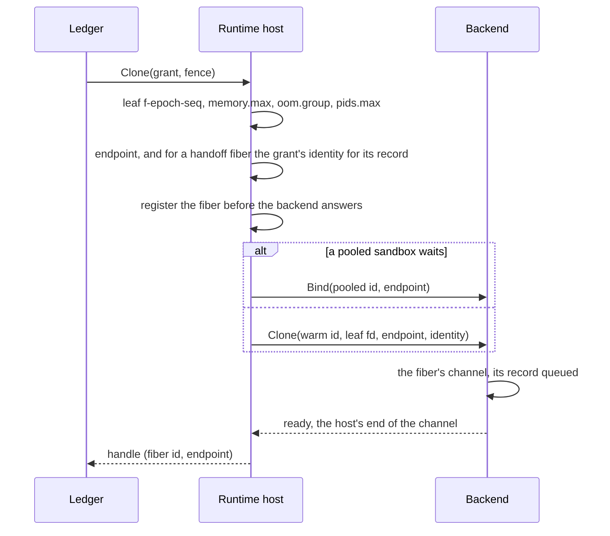
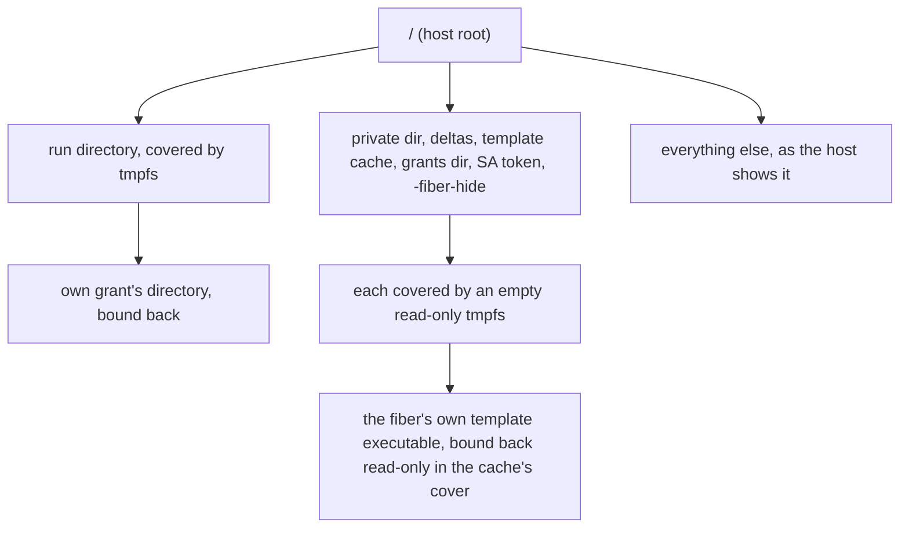

# Design: runtime host

This doc explains the runtime host, the layer between [fiberd](../glossary.md#fiberd)'s ledger and a sandbox [backend](../glossary.md#backend). It is for contributors and backend authors. Read [architecture.md](../architecture.md) first, and [backends.md](backends.md) after this doc.

## Purpose

A backend knows how to fork, checkpoint and restore, and nothing else. Every backend still needs the same surroundings. Each [fiber](../glossary.md#fiber) needs a memory limit, an endpoint and a view of the filesystem that hides fiberd's secrets, and each [park](../glossary.md#park) needs a size bound. The runtime host does that work once, the same way for every backend.

## How it works

- **[Warm](../glossary.md#warm).** At admission the host resolves the [template](../glossary.md#template) (see [artifact.md](artifact.md)), makes the [grant](../glossary.md#grant)'s [cgroup](../glossary.md#cgroup), and asks the backend to start the warm instance in a `zygote` child cgroup. On proc and runc that instance is a [zygote](../glossary.md#zygote). It registers a parent checkpoint for [deltas](../glossary.md#delta), protects the template's pages with `memory.min`, and sets the grant's ceiling. A warm instance that dies is warmed again on the next [Clone](../glossary.md#clone).
- **The leaf.** The host makes a leaf for each fiber, `f-<epoch>-<seq>`, capped at its [W](../glossary.md#w-working-set) [budget](../glossary.md#budget) plus any fixed footprint. proc, runc and gVisor fibers run in it. A Hyperlight fiber is a micro-VM inside the grant's helper, which runs in the grant's cgroup, so its leaf stays empty and the budget is enforced by sampling W. A backend that maps the grant to a user namespace (runc) is given the leaf's `cgroup.procs` and nothing else, so every limit stays the host's. The limits are in [resources.md](resources.md), and the endpoint forms in [networking.md](networking.md).
- **Pool.** On gVisor, `Fill` restores a sandbox ahead of its fiber in a leaf `pool/p-<n>`. A Clone binds the oldest one, and restores on demand when none waits or the hand-out fails. The fiber keeps the leaf, since cgroup v2 cannot rename one. A pooled sandbox is not a fiber until then. The pool drains when the template goes, and a restart removes every `pool/` leaf.
- **W.** On proc and runc, W is the leaf's `memory.current`, and the kernel enforces the budget. gVisor counts W as the leaf's `shmem` less what the leaf held just before the sandbox took its identity, since restores of one image settle MiB apart. A resumed fiber carries on from the W it was parked with. The Hyperlight helper reports W itself. For those backends the leaf gets extra room, and the host samples W every 25 ms and kills a fiber over its budget.
- **Hidden paths.** Fibers must not see the Kubernetes service-account token, fiberd's private directory (keys, ledger, [epoch](../glossary.md#epoch), audit spool), the delta directory, the template cache (pulled templates, their configs and images, the parent checkpoints and the zygote self-checkpoints), `-grants-dir` and every `-fiber-hide` path. proc fibers run as fiberd's uid, so file modes cannot keep them out. A backend that gives fibers their own mount namespace covers each path with an empty read-only tmpfs. A relative path, or one that holds the run directory, is skipped with a log line. A private, delta or template cache directory that holds the run directory fails the start.
- **The fiber's own executable.** A proc zygote warmed from a registry template runs from the cache, and CRIU names a mapped file by its path, which must resolve in the fiber's namespace to the file it maps. So when a hidden directory holds the zygote's own executable, the zygote covers the directory and binds the executable back at its own path, read-only, from a descriptor it opened before the cover ([zygote.md](zygote.md)). A fiber sees the cache as an empty tree with that one file. It sees no other template, no config and no parent. A park dumps the bind by name like the other single-file mounts, and a resume binds the file at that path on the resuming home.
- **Run-directory view.** A proc fiber sees the run directory covered and only its own grant's directory bound back, so other grants' sockets do not exist for it. A park records that bind as an external mount, and a resume binds the resuming grant's directory there.
- **Resume.** A resumed fiber holds its birth [fence](../glossary.md#fence) in memory and learns the new one, its [generation](../glossary.md#generation) and a fresh seed from the record the backend sends on its channel after the restore ([zygote.md](zygote.md)). A Hyperlight fiber gets the same from its helper before it serves ([backends.md](backends.md)). The backend hands the fiber back once it has acked that record, or once the helper says it serves, so nothing is routed to one that never serves again. The host writes nothing under the grant's directory for it.
- **Park termination.** A saved checkpoint does not prove its incarnation ended. The host retains the existing park handshake through kill errors, canceled waits and exit-wait timeouts, returning `ErrParkUnconfirmed` with the saved ref and underlying causes. Routing is detached, but endpoint reservations and core capacity stay held. A retry reuses the same checkpoint and waits for the existing exit/cleanup receipt; it never dumps again. A positively observed exit can complete the park despite an earlier kill-command error. Completed or explicitly discarded parks release their in-memory handshake receipts.
- **Exit evidence.** Pending parks have a separate positive-incarnation-exit receipt, not just the generic cleanup `done` signal. Losing a warm control channel or helper supervision does not supply that receipt: the pending fiber, endpoint and capacity remain held. The backend's additive `Exit.Unconfirmed` flag marks supervision loss and failed waits, including Hyperlight helper hangup and failed gVisor poll/wait. Its false value asserts actual exit evidence; custom backends must mark synthetic notifications explicitly. Adding the field may break external unkeyed Go struct literals, but does not change the RPC. A warm-instance notification is never substituted for a fiber's observed exit. The helper drops its sandbox and listener before `EXITED`. TCP resume transfers check live and pending incarnations together under the reservation lock, so a colliding manifest fence cannot reclaim a quarantined port.
- **Restored process roots.** proc/runc probe pidfd support before restore and capture a read-only pidfd immediately after CRIU returns its trusted root PID, before the resume record exchange. CRIU, its wrapper and a custom commander must use the observer's host PID namespace; the built-in runc wrapper changes only mounts. Root death is observed on that handle, never from supervisor completion (nil, error or signal). If the PID was reused before capture, the original root had already died: the read-only observation may delay proof but cannot prove its death prematurely. This does not authenticate the serving incarnation or change numeric signal/borrow behavior. Root exit status is reported as `exited`, not as the supervisor's exit code.
- **Root-observer failures.** An unsupported observer refuses before starting restore; an already-dead/missing root refuses a serving return and keeps the checkpoint. Other post-birth capture errors keep a successfully acknowledged running incarnation accounted, report the observer failure, and refuse Park before dumping. A later watcher error likewise supplies no death event or released slot; a saved pending checkpoint remains quarantined. Supervisor failure does not stop a valid root watcher, so a late real exit can still complete its park. Each restored fiber owns one pidfd and poller watcher; completion or backend shutdown closes them, and watcher cancellation never manufactures a positive exit. No new channel, checkpoint metadata, Linux 6.5 ancillary feature or public API is required.
- **Failed provisional parks.** Supervision loss while a dump is still in progress is retained rather than discarded. If that park fails without saving a checkpoint, rollback settles the existing ordinary supervision-loss cleanup and exit notification, so it cannot leave an attachable ghost fiber. This does not close the positive termination receipt. If a checkpoint was saved instead, its pending quarantine remains intact.
- **Checkpoint cleanup and endpoints.** A claimed checkpoint's manifest fence alone cannot release a local endpoint reservation. Discard accepts only canonical admitted references and releases parked reservations only for the exact native local checkpoint path; it does not normalize aliases into cleanup authority. Reservation release checks live and pending owners under the same lock as port allocation/transfer. A saved pending path is refused independently of its manifest, so damaged or missing metadata cannot authorize deleting required state. Thus discarding a consumed foreign source after relay fallback cannot free an unconfirmed incarnation's original port. Confirmed local checkpoint cleanup still releases its reservation. As before, an unrelated incomplete or malformed delta can still be removed; an inability to interpret its fence is logged and supplies no endpoint-release authority.
- **Pending parks after restart.** The host validates the saved manifest's fiber identity and restores its endpoint reservation without inferring termination from a missing PID or cgroup. Grant pruning skips these quarantines. Park and Release refuse to complete them without the lost in-process receipt; the checkpoint and reservation stay for repair, while other sessions may run on available capacity/endpoints. This is a conservative local recovery limit, not a distributed ownership mechanism.
- **[Relay](../glossary.md#relay).** Under a TCP family, a backend that cannot bind TCP is told the fiber's unix socket. The host listens on the fiber's port and splices each connection to it, from before the backend's Clone until the fiber ends ([networking.md](networking.md)).
- **Delta quota.** Before a checkpoint, the grant's parked bytes plus the fiber's W must fit in 4 × `fibers.max` × W budget, or 1 GiB when either is unlimited. A park over the quota is refused with [shed](../glossary.md#clone-misses), and the fiber keeps running.
- **Device seam.** A [home](../glossary.md#home) may provision a [device channel](../glossary.md#device-channel) for a grant, and its devices reach the warm instance's environment. An [engine](../glossary.md#engine) reports each fiber's device slice and its own use and capacity. The host kills a fiber over its [device budget](../glossary.md#device-budget), evicts the slice before a park, and feeds occupancy to the pressure ladder.

## Security notes and known gaps

- **Device class not enforced.** A grant asking for a device is admitted when the engine reports any capacity. The host does not compare `device_budget.class` with the engine.
- **Rest of the filesystem.** Paths outside the hidden list are protected only by their owners' permissions.
